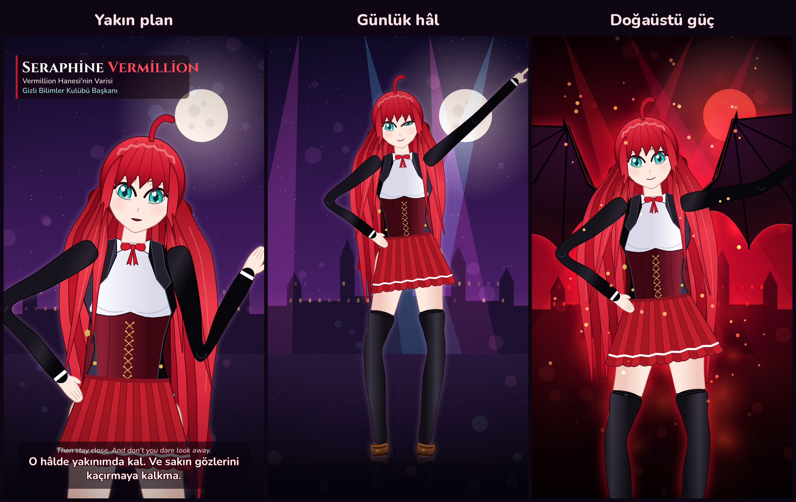

# Seraphine Vermillion — Kodla Çizilmiş Anime Dans Videosu

Tamamen **kodla** üretilmiş bir anime karakteri ve onun dans ettiği, **sentezlenmiş
sesli** dikey bir video. Hiçbir hazır görsel, model ya da çizim kullanılmadı.
Karakter HTML5 Canvas üzerinde vektörel olarak çizildi. Müzik NumPy ile, ses ise yerel
bir TTS modeliyle sentezlendi.

**Çıktılar**
- [`output/seraphine_dans.mp4`](output/seraphine_dans.mp4): 1080×1920, 30 fps, 34,5 sn, AAC stereo, −15 LUFS
- [`output/karakter_tasarimi.png`](output/karakter_tasarimi.png): yakın plan, günlük hâl ve doğaüstü güç kareleri



## Karakter

| | |
|---|---|
| Ad | **Seraphine Vermillion**: Vermillion Hanesi'nin varisi, Gizli Bilimler Kulübü başkanı |
| Boy / oran | 172 cm (≈1500 birim), uzun, olgun ve zarif kum saati silüeti |
| Saç | Uyluklara inen parlak kızıl saç (fizik simülasyonlu 15 tel ve 4 ön tutam), zıplayan ahoge, yüzü çevreleyen uzun perçemler |
| Gözler | İri, hafif çekik, turkuaz degrade iris; çift parlama noktası, göz kırpma |
| Kıyafet | Beyaz gömlek, kırmızı yaka kurdelesi, altın bağcıklı bordo korse yelek, önü açık siyah ceket (klapa, arma, düğmeler), beyaz şeritli kırmızı pileli mini etek, uyluk boyu siyah çoraplar, kahverengi makosenler |
| Güç hâli | Sırttan açılan siyah yarasa kanatları, kızıl-siyah yıkım aurası, alev dilleri, kıvılcımlar, kızıl şimşekler ve dönen sihir çemberi |

Karakter iskelet tabanlı bir rig ile çizilir. Kollarda ileri ve ters kinematik,
bacaklarda ters kinematik (ayaklar yere basar) kullanılır. Gövde kalça ile göğüs
arasında esner. Saç ve etek Verlet fiziğiyle sallanır. Yüz ifadeleri (gülümseme,
göz kırpma, kaş, allık, göz bebeği) ve dudak senkronu sesin genliğinden
hesaplanır.

## Video akışı

| Saniye | Bölüm |
|---|---|
| 0–8 | Yakın plan giriş: el sallar ve sıcak, flörtöz bir tonla konuşur; isim kartı görünür |
| 8–16 | Dans A: yana adım + kol savurma, havada dalgalanma, alkış, dönüş, göz kırparak işaret etme |
| 16–20 | Yükseliş: ciddileşir ve emredici bir tonla konuşur; kanatlar açılır, aura yükselir |
| 20–28 | Drop, Dans B: güçlü kol savurmaları, çapraz açılış, saç savurma, kanat çırpışlı dönüş |
| 28–30 | Final pozu: ışık patlaması ve sarsıntı |
| 30–34,5 | Kameranın kayıtta olduğunu fark eder: yanakları kızarır, sesi incelir |

## Ses

- **Seslendirme:** Yerel çalışan [Kokoro TTS](https://github.com/thewh1teagle/kokoro-onnx) (Apache-2.0)
  kullanıldı. Kadifemsi alto tını için `af_bella` (%60) ve `bf_emma` (%40) sesleri harmanlandı.
  Perde, hız, EQ ve yankı ayarları ffmpeg ile her duyguya göre ayrı yapıldı:
  - sıcak, flörtöz: perde ×0,93
  - soğuk, emredici, aristokratik: perde ×0,88, yavaş, bas ve derin yankı
  - utangaç: perde ×1,05, hızlı
- **Müzik:** NumPy ile sentezlendi: 120 BPM, Re minör. Bölümler müzik kutulu
  giriş, four-on-the-floor dans, trampet rulolu yükseliş, distorsiyonlu bas, koro ve
  lead'li drop. Kanat, patlama ve kıvılcım efektleri de müzikle birlikte sentezlendi.
  Konuşma sırasında müzik kısılır (ducking).
- Replikler İngilizcedir; ekranda Türkçe ve İngilizce altyazı görünür.

## Yeniden üretme

```bash
pip install -r requirements.txt   # ffmpeg, node ve playwright (chromium) de gerekli
./fetch_assets.sh                  # fontlar ve Kokoro ses modeli
python3 src/build.py               # → output/seraphine_dans.mp4
python3 src/build.py --stills 5,24 # belirli saniyelerden PNG kareler
```

Tarayıcıda canlı önizleme için, `build.py` bir kez çalıştırıldıktan sonra
`web/index.html?live` dosyasını açın.

## Dosyalar

| Dosya | Görev |
|---|---|
| `web/character.js` | Karakter: rig, IK, kıyafet, yüz, saç/etek fiziği, kanatlar |
| `web/scene.js` | Koreografi, kamera, arka plan, aura, sihir çemberi, altyazı |
| `src/tts.py` | Kokoro ile seslendirme, ses tasarımı ve dudak senkronu zarfı |
| `src/music.py` | Müzik ve efekt sentezi |
| `src/render.js` | Playwright ile kare çizimi ve ffmpeg'e aktarım |
| `src/build.py` | Tüm üretim hattı ve miksaj |
